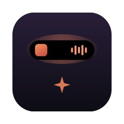
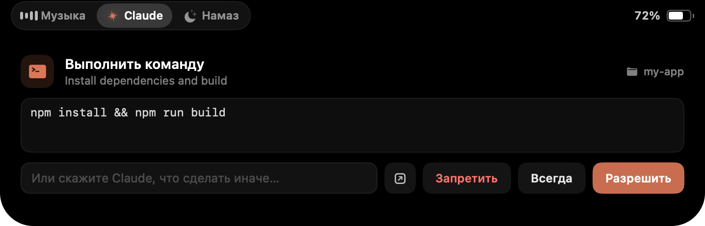
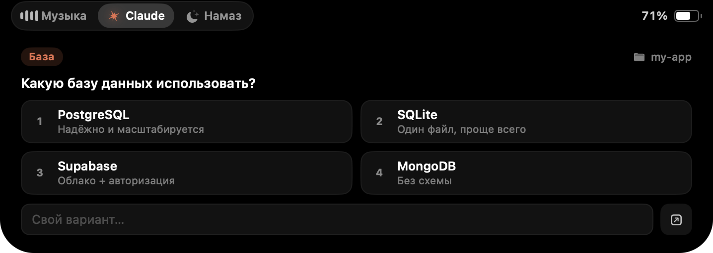
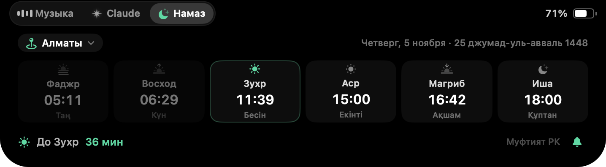

<p align="center">
  
</p>

<h1 align="center">Sezgir Island</h1>

<p align="center">
  Dynamic Island для MacBook с вырезом: музыка, Claude Code и время намаза по Муфтияту РК — прямо в «чёлке».<br>
  <sub>A Dynamic-Island-style notch app for macOS: media controls, Claude Code approvals and Kazakhstan prayer times.</sub>
</p>

<p align="center">
  
</p>

## Возможности

### 🎵 Музыка
- Работает с любым плеером, который попадает в системный «Сейчас играет»: **Яндекс Музыка**, YouTube в браузере, Spotify, Apple Music.
- Пока играет трек — по бокам выреза обложка и эквалайзер. При смене трека остров на пару секунд показывает название.
- Наведите курсор на вырез: обложка с подсветкой в цвет альбома, перемотка, назад / пауза / вперёд.

### ✦ Claude Code
Управляйте Claude Code, не переключаясь в его окно.

- **Разрешения** — остров сам раскрывается и показывает команду или файл: «Разрешить», «Всегда», «Запретить». В поле можно написать, что сделать иначе — Claude получит отказ вместе с вашим текстом.
- **Вопросы Claude** — варианты кнопками или свой ответ.
- **Команды** — пока Claude работает, сообщение дойдёт на следующем шаге. Когда он закончил, у вас ~25 секунд, чтобы ответить, и он сразу продолжит в той же сессии.
- Пока Claude работает, у выреза крутится искра с таймером.
- Если вы сейчас в самом приложении Claude, остров не перехватывает вопросы — отвечайте там как обычно.
- Быстрый вопрос в Claude.app: вкладка Claude или **⌃⌥C** из любого приложения.

<p align="center">
  
</p>

### 🌙 Намаз
- Время по **Духовному управлению мусульман Казахстана** ([muftyat.kz](https://muftyat.kz)): Фаджр, Восход, Зухр, Аср, Магриб, Иша (с казахскими названиями), дата по хиджре, отсчёт до следующего намаза.
- 5 700+ населённых пунктов Казахстана: поиск по-русски, по-казахски или латиницей, либо «Определить автоматически».
- За 10 минут до намаза — отсчёт у выреза, в само время — уведомление и тихий звук.
- Расписание на год сохраняется на диск и работает без интернета.

<p align="center">
  
</p>

### 🔋 И ещё
- Батарея: анимация при подключении зарядки, предупреждение на 20% и 10%.
- Плавные пружинные анимации, переключение вкладок кликом, **⌘1–⌘3** или свайпом двумя пальцами.
- Правый клик по острову: «Claude Code в острове», «Запускать при входе», «Выйти».

## Установка

**Требования:** macOS 14+, Mac на Apple Silicon. Лучше всего смотрится на MacBook с вырезом.

### Готовое приложение
1. Скачайте `Sezgir-Island.zip` со страницы [Releases](../../releases) и перетащите **Sezgir Island.app** в «Программы».
2. Приложение не подписано сертификатом Apple, поэтому при первом запуске: правый клик → **Открыть** → **Открыть**. Или в Терминале:
   ```bash
   xattr -dr com.apple.quarantine "/Applications/Sezgir Island.app"
   ```

### Из исходников
Нужен Xcode (Swift 6).
```bash
git clone https://github.com/Tursunkulov/sezgir-island.git
cd sezgir-island
./build.sh --install
```

Если у вас запущены NotchNook или boringNotch — закройте их: все они занимают один и тот же вырез.

## Подключение Claude Code

Вкладка **Claude** → **«Подключить Claude Code»** (или правый клик → «Claude Code в острове»).

Что произойдёт:
- в `~/.claude/settings.json` добавятся [хуки](https://code.claude.com/docs/en/hooks), а старый файл сохранится как `~/.claude/settings.json.before-dynamic-island`;
- появится скрипт `~/.claude/hooks/dynamic-island-hook.sh`, который пересылает события Claude Code в остров.

Безопасность:
- остров слушает только `127.0.0.1:47823`, каждый запрос проверяется секретным токеном (файл с правами `600` в `~/Library/Application Support/DynamicIsland`);
- если остров не запущен, скрипт ничего не делает, и Claude Code работает как обычно;
- отключить можно в любой момент тем же переключателем — удаляются только записи острова.

## Как это устроено

| Файл | Что делает |
|---|---|
| `Sources/SezgirIsland/NotchPanel.swift`, `NotchShape.swift` | Прозрачная панель над вырезом и форма острова |
| `IslandModel.swift`, `IslandView.swift` | Состояния, наведение, анимации, вкладки |
| `NowPlaying.swift`, `Bridge/` | Системное «Сейчас играет» |
| `ClaudeCodeHub.swift`, `HookServer.swift`, `HookInstaller.swift` | Интеграция с Claude Code через хуки |
| `PrayerTimes.swift`, `PrayerViews.swift` | Время намаза из api.muftyat.kz |

**Про музыку.** С macOS 15.4 обычные приложения не могут читать системный MediaRemote. Маленький мост (`Bridge/bridge.m`) загружается в системный `/usr/bin/perl`, которому это по-прежнему разрешено, и общается с приложением строками JSON. Идея — из [mediaremote-adapter](https://github.com/ungive/mediaremote-adapter).

Скриншоты для README: `open "build/Sezgir Island.app" --args -demo music|claude|prayer|charging|track`.

## Лицензия

[MIT](LICENSE). Проект не связан с Apple, Anthropic или ДУМК. «Dynamic Island» — товарный знак Apple; время намаза предоставляет [muftyat.kz](https://muftyat.kz).
